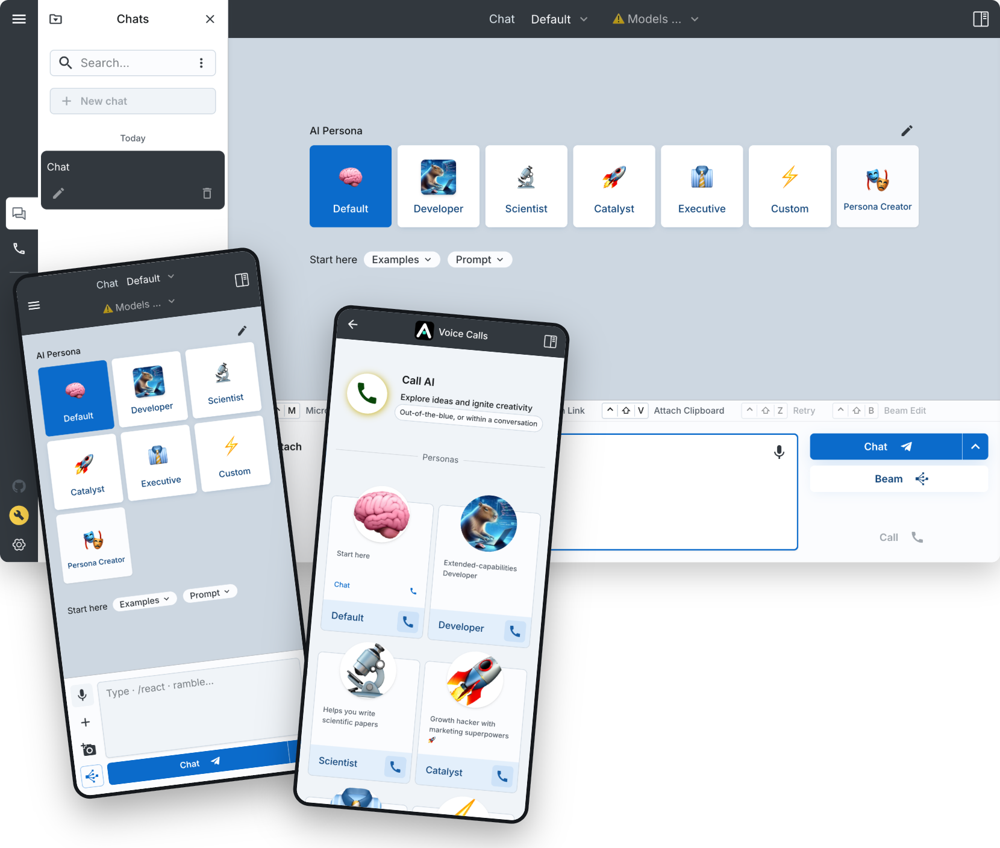

<h1>AI Workspace</h1>

## Provenance

Derived from [enricoros/big-AGI](https://github.com/enricoros/big-AGI) at commit `99b3bf9c` (2026-10-07, v2.1.1), MIT licensed. Upstream changes are reviewed with the `upstream-review` skill (`.claude/skills/upstream-review/`). Issues and releases for this repo: [jrmatherly/ai-workspace](https://github.com/jrmatherly/ai-workspace).

 

# AI Workspace 🧠

**AI Workspace** is a self-hosted, local-first, multi-model AI workspace for experts.

Built for experts: Engineers architecting systems. Founders making decisions. Researchers validating hypotheses.
You need to think broader, decide faster, and build with confidence, then you need AI Workspace.

Beam runs several models on the same prompt and fuses the answers.

&nbsp;
&nbsp;

### What makes AI Workspace different:

**Intelligence**: Beam and Merge run several models on one prompt and fuse the answers; native search; current models from Anthropic, OpenAI, Google, Moonshot, xAI and 19 other vendors.
**Control**: personas, chats stored in your browser, request inspection, your own API keys, no vendor lock-in.
**Speed**: local-first web app, no server round-trip for your data.

## Get Started

Configuration requires your API keys. *AI Workspace does not charge for model usage or limit your access*.

**Self-host and developers** (full control)  
- Develop locally or self-host with Docker on your own infrastructure - [guide](docs/installation.md)  
- Or fork & run on Vercel:  
  

---

## Design principles

**Local-first** (chats stay in your browser), multi-model by default (Beam runs several models side by side with a human in the loop), no vendor lock-in (one AIX protocol layer in front of every provider), and a UI tuned for speed.

---

## Release Notes

Changelog: [docs/changelog.md](docs/changelog.md). Releases: [GitHub releases](https://github.com/jrmatherly/ai-workspace/releases).

## 👉 Supported Models & Integrations

Delightful UX with latest models exclusive features like Beam for **multi-model AI validation**.
> &nbsp;
> 

|  |  |  |  |  |  
|---------------------------------------------------------------------------------------------------------------|-------------------------------------------------------------------------------------------------------------------------|----------------------------------------------------------------------------------------------------------------------|------------------------------------------------------------------------------------------------------------------------|----------------------------------------------------------------------------------------------------------------------| 
| **Chat** **Call** **Beam** **Draw**, ...                                                          | Local & Cloud Open & Closed Cheap & Heavy Google, Mistral, ...                                              | Attachments Diagrams Multi-Chat Mobile-first UI                                                          | Stored Locally Easy self-Host Local actions Data = Gold                                                    | AI Personas Voice Modes Screen Capture Camera + OCR                                                      |

### AI Models & Vendors

Configure 100s of AI models from 20+ providers:

| **AI models**       | _supported vendors_                                                                                                                                                                                                                                                                                                                                                                                                                                                                        |
|:--------------------|:-------------------------------------------------------------------------------------------------------------------------------------------------------------------------------------------------------------------------------------------------------------------------------------------------------------------------------------------------------------------------------------------------------------------------------------------------------------------------------------------|
| Opensource Servers  | [LocalAI](https://localai.io/) · [Ollama](https://ollama.com/)                                                                                                                                                                                                                                                                                                                                                                                                                             |
| Local Servers       | [LM Studio](https://lmstudio.ai/) (non-open)                                                                                                                                                                                                                                                                                                                                                                                                                                               |
| Multimodal services | [Anthropic](https://anthropic.com) · [AWS Bedrock](https://aws.amazon.com/bedrock/) · [Azure](https://azure.microsoft.com/en-us/products/ai-services/openai-service) · [Google Gemini](https://ai.google.dev/) · [Meta AI](https://dev.meta.ai/) · [OpenAI](https://platform.openai.com/docs/overview)                                                                                                                                                                                     |
| LLM services        | [Alibaba](https://www.alibabacloud.com/en/product/modelstudio) · [DeepSeek](https://deepseek.com) · [Groq](https://wow.groq.com/) · [Mistral](https://mistral.ai/) · [Moonshot](https://www.moonshot.cn/) · [NVIDIA NIM](https://build.nvidia.com/) · [OpenRouter](https://openrouter.ai/) · [Perplexity](https://www.perplexity.ai/) · [Together AI](https://www.together.ai/) · [xAI](https://x.ai/) · [Z.ai](https://z.ai/) |
| OpenAI-compatible   | Any OpenAI-compatible endpoint - models, pricing, and capabilities are auto-detected                                                                                                                                                                                                                                                                                                                                                                                                         |
| Image services      | OpenAI · Google Gemini (Nano Banana) · LocalAI                                                                                                                                                                                                                                                                                                                                                                                                                                              |
| Speech services     | [ElevenLabs](https://elevenlabs.io) · [Inworld](https://inworld.ai) · [OpenAI TTS](https://platform.openai.com/docs/guides/text-to-speech) · LocalAI · Browser (Web Speech API)                                                                                                                                                                                                                                                                                                            |

### Additional Integrations

| **More**      | _integrations_                                                                                                 |
|:--------------|:---------------------------------------------------------------------------------------------------------------| 
| Web Browse    | [Browserless](https://www.browserless.io/) · [Puppeteer](https://pptr.dev/)-based                              |
| Web Search    | [Google CSE](https://programmablesearchengine.google.com/)                                                     |

---

## 🚀 Installation

Self-host with Docker, deploy on Vercel, or develop locally. Full setup guide:

---

## Contributing

---

## License

MIT License · [Third-Party Notices](src/modules/3rdparty/THIRD_PARTY_NOTICES.md)

Copyright (c) 2026 Jason Matherly and (c) 2023-2026 Enrico Ros, see [LICENSE](LICENSE).
