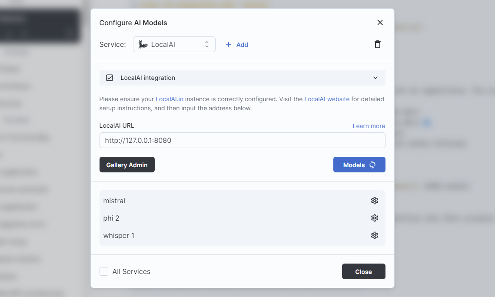
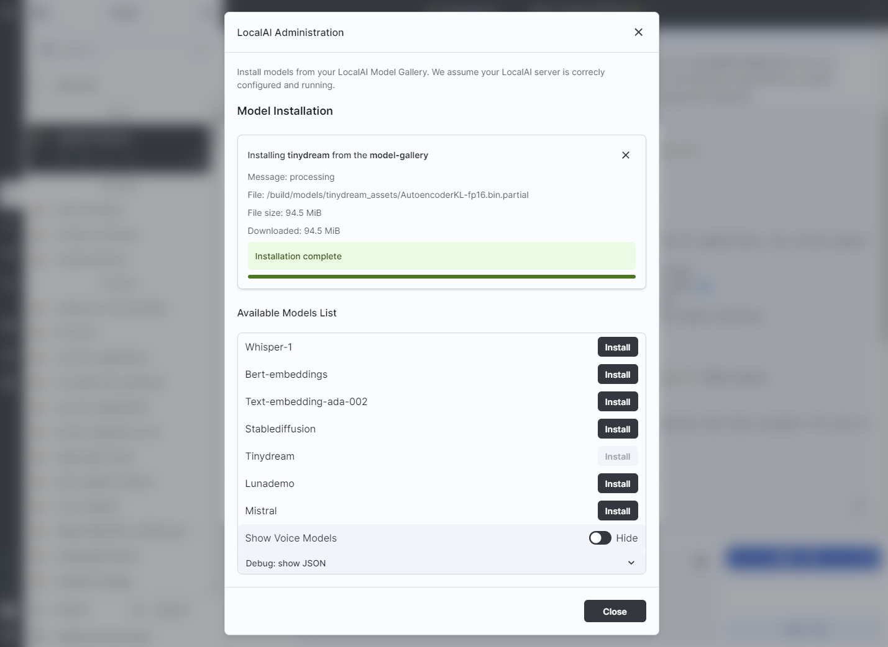

# Run your models with `LocalAI` x AI Workspace

[LocalAI](https://localai.io) lets you run your AI models locally, or in the cloud. It supports text, image, asr, speech, and more models.

We are deepening the integration between the two products. As of the time of writing, we integrate the following features:

- ✅ [Text generation](https://localai.io/features/text-generation/) with GPTs
- ✅ [Function calling](https://localai.io/features/openai-functions/) by GPTs 🆕
- ✅ [Model Gallery](https://localai.io/models/) to list and install models
- ✖️ [Vision API](https://localai.io/features/gpt-vision/) for image chats
- ✖️ [Image generation](https://localai.io/features/image-generation) with stable diffusion
- ✖️ [Audio to Text](https://localai.io/features/audio-to-text/)
- ✖️ [Text to Audio](https://localai.io/features/text-to-audio/)
- ✖️ [Embeddings generation](https://localai.io/features/embeddings/)
- ✖️ [Constrained grammars](https://localai.io/features/constrained_grammars/) (JSON output)
- ✖️ Voice cloning 🆕

*Feature list last updated Feb 21, 2024; the troubleshooting section Oct 12, 2026.*

## Guide

### LocalAI installation and configuration

Follow the guide at: <https://localai.io/basics/getting_started/>

- verify it works by browsing to [http://localhost:8080/v1/models](http://localhost:8080/v1/models)
  (or the IP:Port of the machine, if running remotely) and seeing listed the model(s) you downloaded
  listed in the JSON response.

### Integration: chat with LocalAI

- Go to Models > Add a model source of type: **LocalAI**
- Enter the default address: `http://localhost:8080`, or the address of your localAI cloud instance
  
  - If running remotely, replace localhost with the IP of the machine. Make sure to use the **IP:Port** format
- Load the models (click on `Models 🔄`)
- Select the model and chat

In addition to using the UI, configuration can also be done using
[environment variables](environment-variables.md).

### Integration: Models Gallery

> Note: The Gallery Admin feature described below may have been removed or renamed in recent versions of AI Workspace.

If the running LocalAI instance is configured with a [Model Gallery](https://localai.io/models/):

- Go to Models > LocalAI
- Click on `Gallery Admin`
- Select the models to install, and view installation progress
  

## Troubleshooting

### Context window and max output

The model listing reads each model's `GET /api/models/config-json/<id>` from LocalAI with the configured API key. That route needs
the LocalAI WebUI enabled (it answers 404 with it off, 401 without the key). `context_size` there is the server total, which the
llama-cpp backend splits across its `parallel:N` slots, so the window shown is `context_size / N` (65536 with `parallel:4` is a
16,384-token window) and the max output is half of it, which also becomes the chat's initial response budget. Where LocalAI is
really a llama.cpp `llama-server`, the listing reads `meta.n_ctx` from `/v1/models` and `/props` for tool-call support instead.
If the server declares nothing, the window stays unknown and no `max_tokens` is sent: set it in the model's options under
Expert Overrides.

### Function calling

Auto-diagrams and generative UIs send a tool definition with `tool_choice: auto` plus a system hint, since llama.cpp ignores
`required`. A model that answers in prose instead of calling the tool is treated as "no suggestion" (an info line in the
client logs, no red error), as is a call it rates below the prompt's bar.

## 🤝 Support

- Hop into the [LocalAI Discord](https://discord.gg/uJAeKSAGDy) for support and questions
- For AI Workspace support, please open an issue in the [issue tracker](https://github.com/jrmatherly/ai-workspace/issues)
